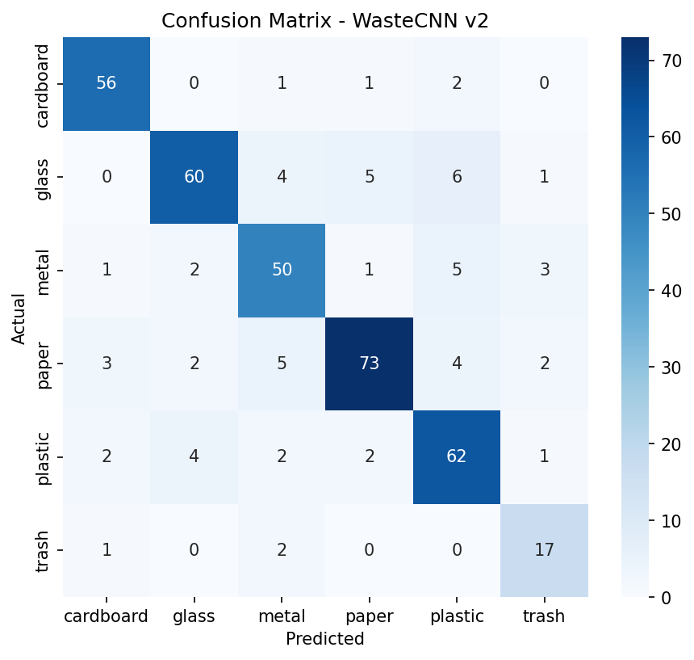

# Waste Classifier (CNN from Scratch)

An image classifier that sorts waste into 6 classes: cardboard, glass, metal, paper, plastic, trash.
The CNN is built and trained from scratch in PyTorch (no pretrained models).

## Dataset
Kaggle "Garbage Classification" dataset (~2,500 images, 6 classes).
Stratified split 70/15/15 (seed 42): 1768 train, 379 validation, 380 test.

## Model
- Custom CNN: 4 blocks (Conv, BatchNorm, ReLU, MaxPool), channels 32 -> 64 -> 128 -> 256
- Adaptive average pooling, Dropout (0.4), Linear layer
- Input size: 128x128

## Training
- Augmentation: horizontal flip, rotation, color jitter
- Class-weighted loss, label smoothing 0.1
- AdamW optimizer with OneCycleLR scheduler
- 80 epochs, early stopping (patience 15)

## Results (test set, 380 images)

| Metric | Value |
|---|---|
| Accuracy | 83.68% |
| Macro F1 | 0.83 |

| Class | Precision | Recall | F1 |
|---|---|---|---|
| cardboard | 0.89 | 0.93 | 0.91 |
| glass | 0.88 | 0.79 | 0.83 |
| metal | 0.78 | 0.81 | 0.79 |
| paper | 0.89 | 0.82 | 0.85 |
| plastic | 0.78 | 0.85 | 0.82 |
| trash | 0.71 | 0.85 | 0.77 |

## Files
- `train_waste_cnn.ipynb`: training and evaluation notebook
- `best_cnn_v2.pt`: trained model weights
- `confusion_matrix_v2.png`: test set confusion matrix

## Live Demo
https://waste-classifier-cnn-hvps4bzkpm745zqpddwsjh.streamlit.app/

